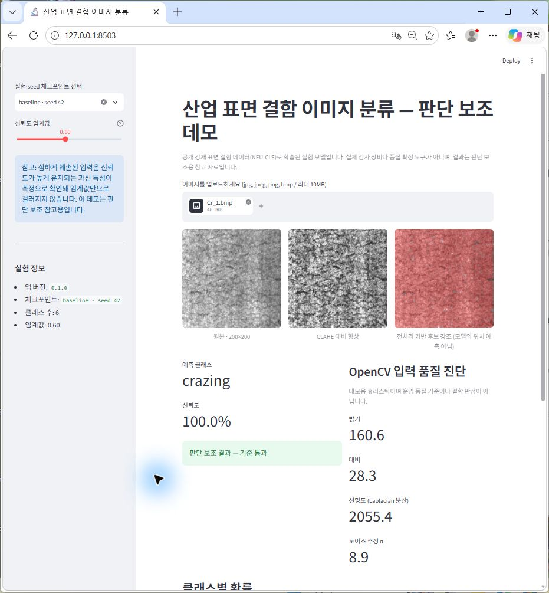

# 데모 결과 화면 증빙

## 현재 OpenCV 화면 (2026-11-14)

- 앱/주소: 산업 표면 결함 이미지 분류 — 판단 보조 데모, `http://127.0.0.1:8503`
- 선택 체크포인트: `baseline · seed 42`
- 실제 업로드 입력: `data/raw/NEU-CLS/Cr_1.bmp` (`Cr_1.bmp`, 40.1 KB)
- 화면 결과: `crazing`, 신뢰도 `100.0%`, `판단 보조 결과 — 기준 통과`
- 화면에 확인된 OpenCV 진단값: 밝기 `160.6`, 대비 `28.3`, 선명도 `2055.4`, 노이즈 추정 σ `8.9`
- 포함 항목: 원본(`200×200`)·CLAHE 대비 향상·빨간 후보 강조·예측/신뢰도·4개 OpenCV 지표. 후보 강조는 모델 위치 예측, 객체 탐지 또는 분할이 아니다.

### 무결성

- 파일: `docs/screenshots/demo-result-baseline-seed42-cr1-opencv.png`
- SHA-256: `023692E71F0F0DEAF827F0853E49F88E1B175626BB3A3D061D23A941A0F8C989`
- 캡처는 Windows Edge에서 실제 Streamlit `file_uploader`를 통해 위 BMP를 업로드한 뒤 수행했다. 브라우저 확대는 화면 내 진단값을 함께 기록하기 위한 75% 표시용 조정이며, 앱의 이미지·모델 입력·예측은 수정하지 않았다.

## 과거 legacy 보관본

`screenshots/demo-result-baseline-legacy-cr1-cropped.png`(SHA-256 `2BD9A10D09790681E1BAD0B74AD9FEE87C009AC3828CE7A13906A173860996C2`)은 OpenCV 패널 도입 전의 legacy 체크포인트 화면이다. 현재 구현 증빙에는 사용하지 않는다.
