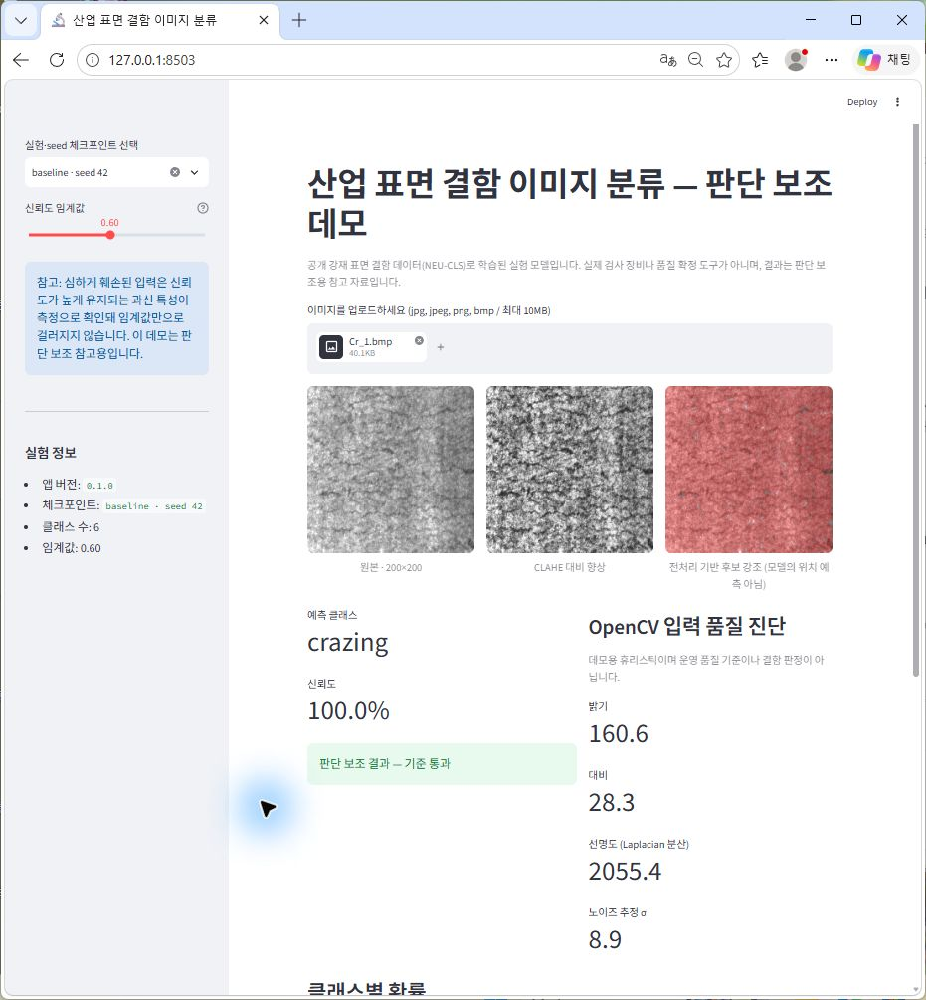

# 산업 표면 결함 이미지 분류

## 20초 요약

> **문제** — 공개 강재 표면 결함 이미지에서 데이터 중복과 누수로 인한 과대평가를 줄이는 재현 실험입니다.
>
> **구현** — SHA-256 중복 제거 후 stratified 70/15/15 분할, ResNet18 전이학습, OpenCV 기반 입력 품질 진단·전처리 시각화와 보류 판단을 포함한 Streamlit 데모, ECE·Brier·NLL·risk-coverage·bootstrap 기반 신뢰도 평가 도구를 구현했습니다.
>
> **결과** — NEU-CLS **1,799장**, seed=42 단일 split에서 test Accuracy·macro F1 **1.0000**, ECE **0.003993**·Brier **0.002065**·NLL **0.004671**(고정 test split 진단), 테스트 **128개 통과**입니다. 실제 현장 일반화 성능은 검증하지 않았습니다.
>
> **실행** — [설치·학습·Streamlit 실행 방법](#실행)과 [실험 결과](02_구현/docs/experiment-results.md)를 확인할 수 있습니다.

> 공개 강재 표면 결함 데이터셋 NEU-CLS를 이용한 **PyTorch 기반 재현 실험**입니다.  
> 실제 생산 라인·검사 장비 성능이나 반도체 데이터가 아닙니다.

## 프로젝트 한눈에 보기

공개 산업 이미지로 데이터 검증부터 사용자 데모까지의 분류 파이프라인을 구현했습니다.

```
데이터 검증 → 중복 제거 → 누수 방지 분할 → ResNet18 전이학습
→ baseline/증강 비교 → 평가·추론 벤치마크 → OpenCV 입력 진단 → Streamlit 판단 보조 데모
```

| 항목 | 내용 |
|---|---|
| 데이터 | NEU-CLS 1,800장 검증 후 중복 1장 제외, **1,799장** 사용 |
| 분할 | Stratified 70/15/15, seed=42 |
| 모델 | ImageNet 사전학습 ResNet18 |
| 평가 | baseline·증강 모두 test Accuracy / macro F1 **1.0000** |
| 신뢰도 | baseline test 270장: ECE **0.003993**, Brier **0.002065**, NLL **0.004671**; bootstrap CI는 고정 split 내 표본 변동만 표현 |
| 재현성 | seed=42 재실행에서 epoch별·test 지표 일치 |
| 테스트 | 합성 fixture와 CPU smoke test를 포함한 **128개 통과** (2026-11-14) |

> 1.0000은 단일 split·seed의 포화 벤치마크 관측값입니다. 실제 현장 성능이나 도메인 일반화 성능을 의미하지 않습니다.

## 핵심 검증

- **데이터 무결성**: `Pa_101.bmp`와 `Pa_105.bmp`의 SHA-256 완전 중복을 발견해 분할 전 제외했습니다.
- **과신 분석**: 같은 validation 이미지에 노이즈·블러를 적용했을 때 정확도는 크게 낮아졌지만 신뢰도가 높게 유지되는 과신 문제를 측정했습니다.
- **판단 보조 UI**: Streamlit 데모에서 입력 형식·크기·픽셀·손상 파일을 검증하고, 밝기·대비·노이즈·선명도 진단 및 전처리 기반 후보 강조를 예측과 함께 표시합니다. PIL 헤더로 픽셀 상한을 먼저 확인한 뒤 OpenCV 디코딩을 수행하므로, 압축률이 높은 초대형 이미지가 디코딩 메모리를 먼저 점유하지 않도록 차단합니다. 후보 강조는 모델의 위치 예측이나 객체 탐지·세그멘테이션이 아닙니다.

## OpenCV 데모 증빙

`baseline · seed 42` 체크포인트에 공식 NEU-CLS `Cr_1.bmp`를 실제 업로드해 캡처한 결과입니다. 원본·CLAHE 대비 향상·전처리 기반 후보 강조, 분류 예측과 신뢰도, 밝기·대비·Laplacian 선명도·노이즈 추정 σ를 한 화면에서 확인할 수 있습니다.



증빙의 SHA-256과 캡처 조건은 [데모 캡처 증빙](02_구현/docs/demo-capture-evidence.md)에 기록했습니다. 이 화면은 입력 품질 진단과 판단 보조를 위한 것이며, 결함 위치를 모델이 예측한 결과나 객체 탐지·세그멘테이션 결과가 아닙니다.

## 기술 스택

`Python` · `PyTorch` · `Torchvision` · `OpenCV` · `Streamlit` · `scikit-learn` · `pytest`

## 실행

구현 코드와 상세 문서는 [02_구현](02_구현) 폴더에 있습니다.

```powershell
cd 02_구현
pip install -r requirements.txt
pip install -e .
python -m pytest -q -p no:cacheprovider --basetemp="$env:TEMP\opencode\pytest-tmp"

python scripts/prepare_data.py --input data/raw/<NEU-CLS.zip 또는 해제 폴더>
python -m defect_cls.train --experiment baseline --seed 42 --device cuda
streamlit run app/demo.py
```

## 문서

- [인수자·LLM 진입점 (AGENTS.md)](AGENTS.md)
- [인수인계·협업 설계 README](01_협업_설계_페이즈/README.md)
- [전문가 A·B·C 교차 검증 및 구현 기록 (2026-11-14)](01_협업_설계_페이즈/08_ABC_교차검증_및_구현.md)
- [상세 README](02_구현/README.md)
- [실험 결과](02_구현/docs/experiment-results.md)
- [신뢰도 평가 계약](02_구현/docs/reliability-evaluation.md)
- [포트폴리오 1페이지 요약](02_구현/docs/portfolio-summary.md)
- [데이터 거버넌스](02_구현/docs/data-governance.md)

## 한계

- 공개 6클래스 벤치마크는 전이학습 모델에 상대적으로 쉬워 성능이 포화됐습니다.
- 실제 현장 데이터, 장비 연동, 실시간 처리 성능, 일반화 성능은 검증하지 않았습니다.
- 합성 훼손 실험은 외부 OOD 평가를 대체하지 않습니다.

## 데이터 출처

NEU Surface Defect Database (NEU-CLS), Northeastern University.  
K. Song and Y. Yan, *A noise robust method based on completed local binary patterns for hot-rolled steel strip surface defects*, Applied Surface Science, 2013.
